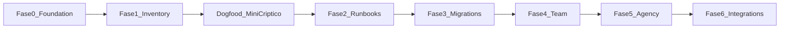

# AccessMap — Roadmap de desarrollo

> **Nombre provisional:** AccessMap · **Repo:** `amanager`  
> **Especificación:** [ACCESSMAP_SPEC_CURSOR.md](./ACCESSMAP_SPEC_CURSOR.md)  
> **Última actualización:** 2026-11-19 (v0.2)

## Visión del roadmap

Construir de forma incremental un mapa de control de infraestructura digital **sin almacenar credenciales**. El primer hito utilizable es **dogfood de inventario** (Fase 1): registrar Mini Críptico y responder las preguntas de la spec §4.4. Runbooks y planes de migración vienen después.

## Decisiones de stack (no reabrir en F0–F1)

| Área | Decisión |
| --- | --- |
| Runtime / pkg | bun |
| App | Nuxt 4, Vue 3, TypeScript, Nitro |
| DB | PostgreSQL 16, Drizzle ORM, driver `pg` |
| Auth | Sesiones propias (cookie HTTP-only); primer user = owner; signup cerrado después |
| i18n | `en` (default) + `es`, `@nuxtjs/i18n`, **`strategy: 'no_prefix'`** (cookie, mismas URLs) |
| UI | Tailwind + Reka UI + iconos propios (`app/components/icons/`) |
| Dev infra | `compose.dev.yml`: Postgres + Mailpit; app en host |
| Prod infra | `compose.prod.yml`: app + Postgres + Caddy |

## Fase 0 — Base (vertical slice)

**Objetivo:** autenticación real, workspace aislado, primer recurso en Postgres.

### Entregables

| PR | Contenido |
| --- | --- |
| **OR-0.1** | `compose.dev.yml`, `compose.prod.yml`, `Dockerfile`, `.env.example`, scripts `bun` |
| **OR-0.2** | Scaffold Nuxt 4, Tailwind, Reka UI, `AppIcon` base, layout shell |
| **OR-0.3** | Drizzle schema núcleo (`users`, `sessions`, `workspaces`, `workspace_members`, `projects`, `assets` mínimo), migraciones |
| **OR-0.4** | Auth: register (solo sin users), login, logout, password reset (Mailpit en dev) |
| **OR-0.5** | Workspace personal auto al registrar; middleware de sesión + `workspace_id` en queries |
| **OR-0.6** | i18n `en`/`es`, locale cookie, selector en UI |
| **OR-0.7** | Tests: usuario A no lee datos de workspace B |

### Criterio de salida

Login → workspace personal → crear proyecto → crear un asset persistido en PostgreSQL. Sin mocks que simulen APIs externas.

---

## Fase 1 — Inventario usable (dogfood)

**Pathfinder:** [product/plans/accessmap-phase-1/map.md](../product/plans/accessmap-phase-1/map.md) · contrato [product/specs/accessmap-phase-1.md](../product/specs/accessmap-phase-1.md) (v0.2.0).

**Objetivo:** inventario completo + onboarding + CSV; criterio **spec §26.A** y **§4.4**.

### Sub-entregas (PRs)

| PR | Contenido |
| --- | --- |
| **OR-1a** | CRUD: `project_environments`, `providers`, `provider_accounts`, `identities`, `email_addresses`, relaciones email↔identity |
| **OR-1a** | CRUD: `assets`, `project_assets`, `asset_roles`, `config_entries`, `vault_references`, `verifications` |
| **OR-1b** | `asset_dependencies`, API + UI de impacto (lista, BFS, profundidad máxima, estados de verificación) |
| **OR-1c** | Wizard 5 pasos (spec §6): borradores, «not sure yet», solo «My projects» en paso 1 |
| **OR-1d** | CSV import preview/commit + export; rechazo de columnas con patrones de secreto |
| **OR-1e** | Búsqueda y filtros con paginación servidor; seed ficticio Mini Críptico (`unverified` markers). **Re-ejecutar** `bun run db:seed --workspace=<uuid>` **sustituye** el demo Mini Críptico del workspace (no hace skip). |
| **OR-1f** | UI `config_entries` en detalle de asset (OAuth: client ID, redirect URIs por entorno, orígenes JS); solo metadatos públicos o referencia sensible. |
| **OR-1g** | **Grafo visual de dependencias** (cierre F1): vista en proyecto y acceso desde asset; aristas con tipos traducidos y estados de verificación. Lista BFS (OR-1b) sigue siendo la vista por defecto. |
| **OR-1h** | **Tabs en vistas de detalle** (proyecto, activo, identidad, accounts): navegación por secciones con Reka UI + query `?tab=` compartible. |

### Fuera de Fase 1

- Clientes / modo agencia en UI
- Invitaciones, billing
- Integraciones OAuth con proveedores del inventario
- Runbooks y migration plans (Fase 2–3)

### Criterio de salida

Inventariar Mini Críptico (manual, wizard o CSV) y responder las 10 preguntas de §4.4 con datos trazables y sin secretos. Checklist: [DOGFOOD_CHECKLIST.md](./DOGFOOD_CHECKLIST.md) y página in-app `/checklist`.

---

## Fase 2 — Runbooks y README

Copiar salidas de spec §21:

- Plantillas de setup (≥3)
- Generación de guía por proyecto/entorno
- Pasos con DAG, ejecución manual, historial
- Export Markdown en locale activo

**Salida:** README de incorporación útil para Mini Críptico (sin contraseñas ni pasos inventados).

---

## Fase 3 — Planes de migración

- Motor de plantillas (`github-to-bitbucket`, `registrar-to-registrar`, …)
- Impacto desde grafo documentado + candidatos no verificados
- Estados, preflight, rollback explícito, exportación
- Ejecución manual auditada (no automatización operativa)

**Salida:** dos planes concretos de Mini Críptico (spec §26.B).

---

## Fase 4 — Colaboración

Invitaciones, roles `owner|admin|editor|viewer`, offboarding, auditoría, compartir proyecto personal → equipo con preview.

**Salida:** dos usuarios colaboran sin cross-tenant leaks.

---

## Fase 5 — Agencias

Clientes, permisos por cliente/proyecto, importación masiva, handover, escala (paginación/índices), billing según validación.

---

## Fase 6 — Integraciones opt-in

GitHub, Google Cloud (alcance mínimo), Cloudflare, AWS, DNS — solo lectura, consentimiento explícito. Login de AccessMap con Google ≠ inspección del inventario Google del usuario.

---

## Modelo de datos (F0–F1)

Tablas mínimas alineadas con spec §15:

`users`, `sessions`, `workspaces`, `workspace_members`, `projects`, `project_environments`, `providers`, `identities`, `email_addresses`, `identity_emails`, `provider_accounts`, `assets`, `project_assets`, `asset_roles`, `asset_dependencies`, `config_entries`, `vault_references`, `verifications`, `audit_events`.

`clients` puede existir en schema con `client_id` nullable en proyectos; **sin UI** hasta Fase 5.

**Reglas SQL:** aislamiento por `workspace_id`; FKs compuestas donde aplique; no cascade que borre auditoría.

---

## Skills del proyecto (Cursor)

Skills en `.cursor/skills/` para guiar implementación y QA:

| Skill | Uso |
| --- | --- |
| `no-secrets` | Forms, CSV, seeds, logs, exports |
| `domain-model` | Schema, API, UI de inventario |
| `i18n-en-es` | Cualquier copy de UI |
| `nuxt-drizzle-stack` | Scaffold, Compose, auth, queries |
| `minicriptico-dogfood` | Seed y criterios de aceptación Fase 1 |
| `provider-brand-icon` | Nuevo proveedor o tipo de asset: icono oficial vía Simple Icons + `brandIcons.ts` |

### Skills sugeridas (F2+, no creadas aún)

| Skill | Cuándo |
| --- | --- |
| `runbook-author` | Fase 2: plantillas, freeze de ejecución, Markdown sin interpolar tokens |
| `migration-planner` | Fase 3: plan ≠ ejecución; DNS ≠ registrador ≠ hosting |
| `tdd-slice` | Durante build: red-green en API + Drizzle |

Usar también skills existentes del repo: **pathfinder** (planificación), **grill-me** (decisiones de producto).

---

## Referencia rápida: «hecho» por fase

| Hito | Sección spec |
| --- | --- |
| Dogfood inventario | §26.A — fin Fase 1 |
| README + 2 migraciones | §26.B — Fase 2 + 3 |
| Equipo | Fase 4 |
| Agencia | Fase 5 |